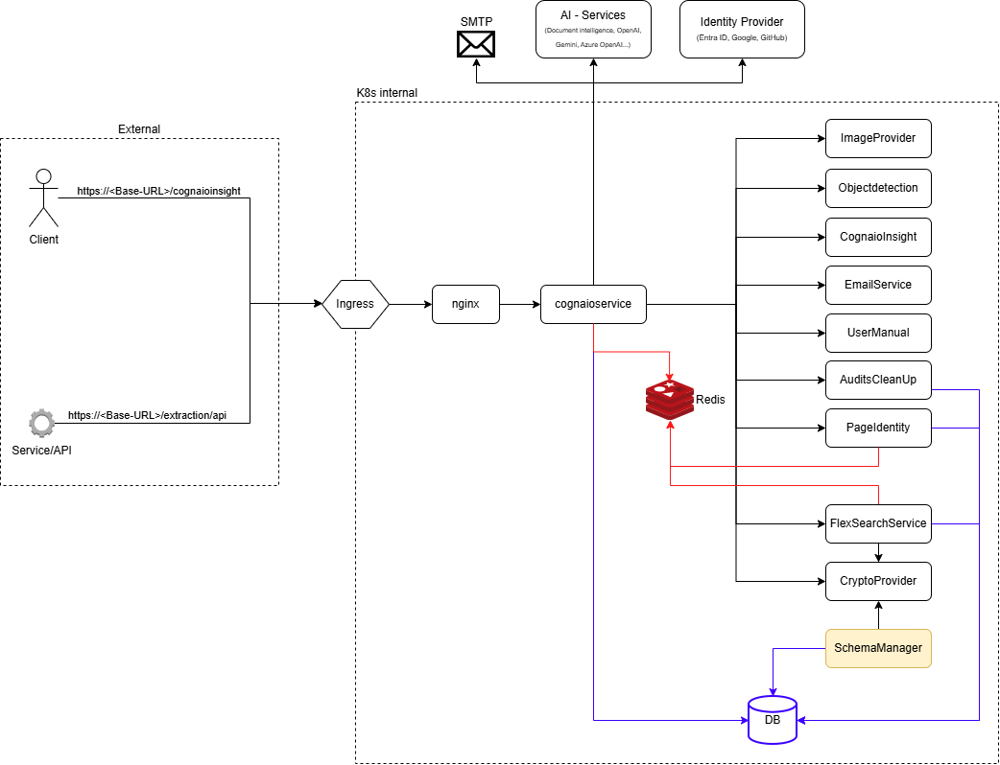
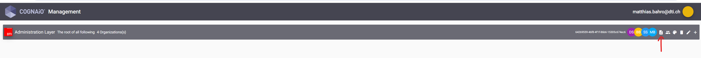
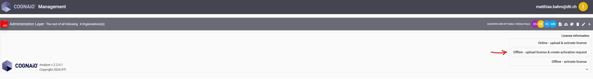
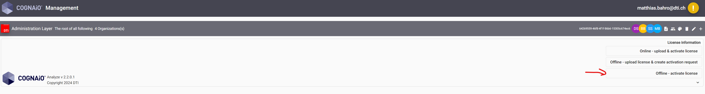
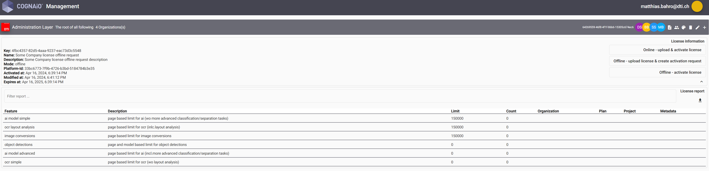

# Helm Repository for COGNAiO® Cloud Extract
This chart bootstraps a [COGNAiO®](https://dti.group/en/) cloud extract deployment on a [Kubernetes](https://kubernetes.io/) cluster using the [Helm](https://helm.sh/) package manager.

## Deployment Instructions
This repository provides a microservices architecture deployment setup, managed via [Helm](https://helm.sh/). The microservices are containerized, and images are hosted on our private image registry. Customers have the following options for obtaining these images:

### Pull Images from Our Registry (default)
Customers can pull images directly from our private registry. To do this, please **contact us to obtain the required credentials**. Once you receive the credentials, update your Helm configuration with the authentication details to access our registry.

### Receive Images Directly (alternative)
If you prefer not to connect directly to our registry, we can provide you with the images. Please **get in touch with us** to arrange image delivery. After receiving the images, import them into your local registry, and update the Helm configuration to reference your local repository.

### Ongoing Updates
Our team actively maintains this repository, providing updates to Helm charts and container images to ensure that bug fixes, security patches, and new feature versions are available. These updates are publicly accessible through this GitHub repository. Please check regularly or subscribe to notifications to stay informed about the latest releases.

### Migration and Backup

Our application images are fully stateless, with all persistent data stored exclusively in the database. This design ensures that ongoing updates and new deployments are seamless, as no data is stored within the application containers themselves. Because of this stateless architecture, customers can confidently update to new versions without disrupting application functionality or data integrity.

The data stored in the database is limited to statistical data, license information, and application configuration; no customer data is stored. For customers updating to a new version, the `cognaioschemamanager` Job handles all necessary database migrations. This process ensures a smooth transition to the latest version without manual intervention. Up to 3.0.x that job ran as an init container inside the `cognaioservice` pod; since 3.1.0 it is a standalone Job that runs on every rollout - see [Rollout Order](#rollout-order).

We strongly recommend backing up the database before any update to safeguard against data loss during the migration process. Back up **all** schemas from the same run, `cognaio_extensions` included: that is where the key rows live that every encrypted value depends on, so a newer data backup restored onto an older key backup points at keys that do not exist.

> ⚠️ **Since 3.1.0 the database is no longer the only thing to back up.** Two pieces of key material live outside it and cannot be recovered from a database dump:
> - the **platform main key (KEK)** - in your Azure Key Vault / AWS KMS / GCP KMS when `cryptoprovider.env.kek.provider` points at a vault, and in your values file when it does not. It is the vault's own backup that covers the first case; nothing covers the second but you.
> - the **voucher key** (`cryptoprovider.env.cryptoVoucherKeyB64`) - never in the database, and its loss makes the data of every organization with its own key permanently unreadable. No recovery path, no back door.
>
> Back both up the way you back up the database, and try the restore once. See [Crypto Provider (KEK Custody)](#crypto-provider-kek-custody).

To ensure all updates work as expected, we recommend testing deployments in a **staging environment** prior to deploying to production. This allows you to verify the functionality and compatibility of the new version in a controlled setting.


## Architecture Overview
The following diagram illustrates how the COGNAiO Cloud Extract microservices communicate within the Kubernetes cluster and with external systems.



### Services

**nginx**
Service that serves as the single gateway for all external traffic entering the cluster. It routes requests to the appropriate internal services. In future versions, this component will be replaced by native Kubernetes ingress capabilities.

**cognaioservice**
Central API service and primary orchestrator of the platform. Handles user authentication, request routing, email notifications, database operations, and Redis-based caching. Communicates with AI services (Azure OpenAI, Document Intelligence, AWS Textract, etc.) and contains the core business logic of COGNAiO Cloud Extract.

**imageprovider**
Normalizes heterogeneous document inputs (PDF, TIFF, scanned images, etc.) into well-formatted, standardized images through format conversion and preprocessing. Runs with multiple replicas by default to handle concurrent processing workloads.

**objectdetectionprovider**
Provides machine-learning-based object detection using a YOLO model to identify specific document elements such as signatures, stamps, or checkboxes. Must be explicitly activated per project within the platform configuration. If object detection is not required, this service can safely be scaled to zero replicas.

**emailservice**
Connects to external Microsoft Exchange mailboxes via the Microsoft Graph API to process inbound emails for automated document ingestion. If automated email processing is not required, this service can safely be scaled to zero replicas.

**cognaioflexsearchservice**
Manages repository data, providing storage and retrieval capabilities for indexed document content. If the repository feature is not required, this service can safely be scaled to zero replicas.

**cognaioinsightagentic**
Primary web-based user interface (agentic experience) for interacting with the COGNAiO Cloud Extract platform. Provides access to document processing workflows, project configuration, administration, and result review.

**usermanual**
Serves the official user documentation, accessible directly from the cognaioinsight-agentic UI.

**cognaioauditscleanup**
Runs periodic cleanup jobs to remove expired audit records and temporary data from the database, ensuring long-term storage efficiency.

**pageidentityservice**
Stores visual page fingerprints (page identities) sent by `cognaioservice` and answers distinct-page count reports on demand. It owns its own PostgreSQL schema (`cognaio_page_identity`) and uses the shared Redis for caching and cross-instance locking.

**cryptoprovider**
Sole holder of the platform main key: it locks and unlocks the data keys that `cognaioservice`, `cognaioflexsearchservice` and `cognaioschemamanager` send it, and does nothing else. It sees no documents, no customer data and no database - only short key values. This keeps the two halves apart: whoever reaches the database finds encrypted data keys, worthless without the main key, and whoever holds the main key has no database access. New and mandatory since 3.1.0 - its three callers refuse to start without it. Reachable in-cluster only, never through nginx or an ingress.

**cognaioschemamanager**
Creates and migrates the PostgreSQL schemas, and since 3.1.0 also checks on every start that every key row still opens under the currently configured main key, moving the stale ones over. Runs as a Job on every rollout and exits; the services that read its schemas wait for it. Up to 3.0.x it was an init container inside the `cognaioservice` pod.

**redis**
In-memory cache used for temporary data storage during document processing operations. Data is non-persistent and is not backed up.

## Prerequisites
### Tools & Skills
- Basic knowledge of Helm and deployments in Kubernetes
- [Install Azure CLI](https://learn.microsoft.com/en-us/cli/azure/install-azure-cli)
- [Install Kubectl](https://kubernetes.io/docs/tasks/tools/install-kubectl-windows/)
- [Install Helm](https://helm.sh/docs/intro/install/)
- Running [Infrastructure for COGNAiO®](https://github.com/dti-cognaio/cognaio-cloud-extract-iac) cloud extract
- Right Permissions in Azure and needed resources
  - Make sure the user or service principal who deploys this Helm Charts has the right permission in the AKS Azure resource (RBAC Cluster Admin Role)

### Connect to Cluster (Azure)
Get the relevant information from the Azure portal
```sh
az login
```
```sh
az account set --subscription <Subscription>
```
```sh
az aks get-credentials --resource-group <ResourceGroup> --name <AKS-Name>
```

## Configuration and installation details
### Secrets
All secrets can be individually controlled via the property `secret.init`, whether they should be created automatically by the deployment or not. If they are to be created, the required parameters must be filled in - see further descriptions below. If not, the already created secret can be used via `secret.name`.

### Global Values
The following global values apply to all deployments in the chart. These can be overridden per service where applicable.
| Name                                                                                     | Description                                                        | Default                                              |
|:-----------------------------------------------------------------------------------------|:-------------------------------------------------------------------|:-----------------------------------------------------|
| `image.containerRegistry`                                                                | Container registry where all images are placed                     | `dtideregistry.azurecr.io`                           |
| `image.pullPolicy`                                                                       | Image pull policy for all containers                               | `Always`                                             |
| `image.restartPolicy`                                                                    | Global restart policy for all pods                                 | `Always`                                             |
| `imagePullSecrets`                                                                       | Image pull secrets for private registries                          | `[]`                                                 |
| `podAnnotations`                                                                         | Global pod annotations applied to all deployments                  | `{}`                                                 |
| `podSecurityContext`                                                                     | Global pod security context applied to all deployments             | `{}`                                                 |
| `securityContext`                                                                        | Global container security context applied to all deployments       | `{}`                                                 |
| `annotations`                                                                            | Global annotations applied to all resources                        | `{}`                                                 |
| `labels`                                                                                 | Global labels applied to all resources                             | `{}`                                                 |
| `cognaio.namespace`                                                                      | Kubernetes namespace for the deployment                            | `cognaio-idp`                                        |
| `cognaio.url`                                                                            | Base URL to COGNAiO App                                            | `""`                                                 |
| `cognaio.protocol`                                                                       | Protocol for the base URL                                          | `https`                                              |
| `cognaio.wildcardUrl`                                                                    | Base URL wildcard for ingress                                      | `""`                                                 |
| `cognaio.cert.certificate`                                                               | Certificate for TLS termination in pem format                      | `""`                                                 |
| `cognaio.cert.key`                                                                       | Certificate Key for TLS termination in pem format                  | `""`                                                 |
| `cognaio.cert.secret.name`                                                               | Secret name, details in `cognaio-tls-secret.yaml`                  | `cognaio-com-tls-secret`                             |
| `cognaio.cert.secret.init`                                                               | Whether or not to create a secret                                  | `true`                                               |
| `cognaio.ingress.enabled`                                                                | Enable deployment of ingress                                       | `true`                                               |

### Per-Service Common Parameters
Each service supports the following common parameters. Replace `<service>` with the service key (e.g., `cognaioservice`, `nginx`, `redis`, etc.).
| Name                                                                                     | Description                                                        | Default (varies)                                     |
|:-----------------------------------------------------------------------------------------|:-------------------------------------------------------------------|:-----------------------------------------------------|
| `<service>.name`                                                                         | Name used for deployment and service resources                     | (service-specific)                                   |
| `<service>.replicaCount`                                                                 | Number of replicas                                                 | `1`                                                  |
| `<service>.autoscaling.enabled`                                                          | Enable horizontal pod autoscaling                                  | `false`                                              |
| `<service>.autoscaling.minReplicas`                                                      | Minimum replicas for HPA                                           | `1`                                                  |
| `<service>.autoscaling.maxReplicas`                                                      | Maximum replicas for HPA                                           | `100`                                                |
| `<service>.autoscaling.targetCPUUtilizationPercentage`                                   | Target CPU utilization for HPA                                     | `80`                                                 |
| `<service>.autoscaling.targetMemoryUtilizationPercentage`                                | Target memory utilization for HPA                                  | `80`                                                 |
| `<service>.podLabels`                                                                    | Additional labels applied to pods                                  | (service-specific)                                   |
| `<service>.podSelectorLabels`                                                            | Immutable selector labels for pods                                 | (service-specific)                                   |
| `<service>.serviceAccount.create`                                                        | Whether to create a service account                                | `false`                                              |
| `<service>.serviceAccount.annotations`                                                   | Annotations for the service account                                | `{}`                                                 |
| `<service>.serviceAccount.name`                                                          | Name of the service account                                        | `default`                                            |
| `<service>.serviceAccount.automount`                                                     | Automount service account token                                    | `false`                                              |
| `<service>.podSecurityContext`                                                           | Pod security context (overrides global)                            | `{}`                                                 |
| `<service>.securityContext`                                                              | Container security context (overrides global)                      | `{}`                                                 |
| `<service>.nodeSelector`                                                                 | Node selector for pod scheduling                                   | `{}`                                                 |
| `<service>.tolerations`                                                                  | Tolerations for pod scheduling                                     | `[]`                                                 |
| `<service>.affinity`                                                                     | Affinity rules for pod scheduling                                  | `{}`                                                 |
| `<service>.topologySpreadConstraints`                                                     | Pod topology spread constraints (per component, no global default) | `[]`                                                 |
| `<service>.resources`                                                                    | CPU/memory resource requests and limits                            | (service-specific)                                   |
| `<service>.restartPolicy`                                                                | Restart policy for the pod (overrides global `image.restartPolicy`) | `Always`                                            |
| `<service>.lifecycle`                                                                    | Container lifecycle hooks (e.g., preStop for graceful shutdown)    | `{}`                                                 |
| `<service>.extraEnv`                                                                     | Additional environment variables as array                          | `[]`                                                 |
| `<service>.extraContainers`                                                              | Additional sidecar containers to inject into the pod (free-form)   | `[]`                                                 |
| `<service>.otel`                                                                         | Per-service OpenTelemetry overrides (`enabled`, `serviceName`, `endpoint`, `captureHeaders`), see [OpenTelemetry](#opentelemetry-observability) | `{}`   |

### Extra Containers (Sidecars)
Every service deployment exposes an `extraContainers` extension point that lets you inject additional sidecar containers into the pod without modifying the chart. The list is rendered verbatim into `spec.template.spec.containers`, so any valid Kubernetes container spec is accepted (image, env, ports, volumeMounts, resources, etc.).

A typical use case is running an authentication proxy in front of `cognaioservice`:

```yaml
cognaioservice:
  extraContainers:
    - name: authentication-proxy
      image: myregistry/auth-proxy:1.0.0
      ports:
        - containerPort: 8081
      env:
        - name: UPSTREAM
          value: "http://localhost:3000"
```

The same field is available on every service (`nginx`, `usermanual`, `redis`, `cognaioinsightagentic`, `cognaioservice`, `emailservice`, `cognaioflexsearchservice`, `imageprovider`, `cognaioauditscleanup`, `objectdetectionprovider`, `pageidentityservice`, `cryptoprovider`). When `extraContainers` is left empty (the default), no additional containers are added.

> ℹ️ Sidecars share the pod's network namespace, so they can reach the main container at `localhost:<containerPort>`. If a sidecar needs its own writable filesystem, add the corresponding entries via `<service>.additionalVolumes` and reference them through the sidecar's `volumeMounts`.

### Cognitive Service Endpoints
Our application integrates with multiple Azure resources, which are detailed in our [infrastructure](https://github.com/dti-cognaio/cognaio-cloud-extract-iac) GitHub repository. However, certain configuration details for deploying COGNAiO® Cloud Extract must be retrieved directly from the Azure portal. Please navigate to each relevant resource and locate the required endpoint information.

While Azure is our preferred platform for AI services, our solution also supports a variety of alternatives, including AWS, ChatGPT, DeepSeek, Gemini, and more.

### Azure
|Name                                                                 | Resource                                              | Example / Description                                                            |
|:--------------------------------------------------------------------|:------------------------------------------------------|:---------------------------------------------------------------------------------|
|`cognaioservice.env.ai.apikeyAzureOpenAi`                            | Microsoft.CognitiveServices - Kind: OpenAI            | See Azure Portal on the Resource --> Resource Management --> `Keys and Endpoint` |
|`cognaioservice.env.ai.endpointAzureOpenAi`                          | Microsoft.CognitiveServices - Kind: OpenAI            | `https://<RESOURCE NAME>.openai.azure.com`                                       |
|`cognaioservice.env.ai.apikeyAzureAiDocumentIntelligence`            | Microsoft.CognitiveServices - Kind: FormRecognizer    | See Azure Portal on the Resource --> Resource Management --> `Keys and Endpoint` |
|`cognaioservice.env.ai.endpointAzureAiDocumentIntelligence`          | Microsoft.CognitiveServices - Kind: FormRecognizer    | `https://<RESOURCE NAME>.cognitiveservices.azure.com/`                           |
|`cognaioservice.env.ai.apikeyAzureCognitiveServicesComputervision`   | Microsoft.CognitiveServices - Kind: CognitiveServices | See Azure Portal on the Resource --> Resource Management --> `Keys and Endpoint` |
|`cognaioservice.env.ai.endpointAzureCognitiveServicesComputerVision` | Microsoft.CognitiveServices - Kind: CognitiveServices | `https://<LOCATION>.api.cognitive.microsoft.com/`                                |
|`cognaioservice.env.ai.apikeyAiFoundry`                              | Microsoft.CognitiveServices - Kind: AIServices        | See Azure Portal --> Azure Foundry portal                                        |
|`cognaioservice.env.ai.endpointAiFoundry`                            | Microsoft.CognitiveServices - Kind: AIServices        | See Azure Portal --> Azure Foundry portal                                        |

### AWS
|Name                                                                 | Resource                                              | Example / Description                                                                                  |
|:--------------------------------------------------------------------|:------------------------------------------------------|:-------------------------------------------------------------------------------------------------------|
|`cognaioservice.env.aws.accesskeyIdAwsTextract`                      | Amazon Textract resource                              | Create a service user in AWS with resource access and generate the corresponding access and secret key.|
|`cognaioservice.env.aws.secretAccessKeyAwsTextract`                  | Amazon Textract resource                              | Create a service user in AWS with resource access and generate the corresponding access and secret key.|
|`cognaioservice.env.aws.regionAwsTextract`                           | Amazon Textract resource region                       | `eu-central-1`                                                                                         |
|`cognaioservice.env.aws.accesskeyIdAwsBedrock`                       | Amazon Bedrock resource                               | Create a service user in AWS with resource access and generate the corresponding access and secret key.|
|`cognaioservice.env.aws.secretAccessKeyAwsBedrock`                   | Amazon Bedrock resource                               | Create a service user in AWS with resource access and generate the corresponding access and secret key.|
|`cognaioservice.env.aws.regionAwsBedrock`                            | Amazon Bedrock resource region                        | `eu-central-1`                                                                                         |

### Other Ai Services
If you want to use other Ai services you can provide following information otherwise it can be empty.
|Name                                           | Resource            | Example / Description                                 |
|:----------------------------------------------|:--------------------|:------------------------------------------------------|
|`cognaioservice.env.ai.apikeyNativeOpenAi`     | openai.io           | Create individual ApiKey in your openAi account       |
|`cognaioservice.env.ai.endpointNativeOpenAi`   | openai.io           |`"https://api.openai.com/v1"`                          |
|`cognaioservice.env.ai.apikeyNativeGemini`     | google Gemini       |`"https://gemini.google.com/app"`                      |
|`cognaioservice.env.ai.apikeyNativeAnthropic`  | Anthropic           |`"https://api.anthropic.com"`                          |
|`cognaioservice.env.ai.apikeyNativeCerebral`   | Cerebral            |`"https://cerebralai.com.au/"`                         |
|`cognaioservice.env.ai.endpointNativeCerebral` | Cerebral            |`"https://cerebralai.com.au/"`                         |


### Edit AI Endpoints directly in UI
> ⚠️ From version 2.5 onwards

The endpoints for AI services can be configured directly in COGNAiO UI. Because the database is encrypted, it requires a private and public key, which must be included in the deployment.
There are two ways to create these.
1. Existing COGNAiO 2.5+ installation
```sh
GET <BASE_URL>/extraction/api/crypto/generatekeypair
```
> ‼️ When this endpoint is used, the cognaioservice.env.tokens.passPhraseCryptoAsymetric that already exists in the deployment is automatically used. This means that these generated keys only work on systems that use the same key!
2. Using the openssl tool
```sh
openssl genpkey -algorithm RSA -out private_key.pem -pkeyopt rsa_keygen_bits:4096 -aes-256-cbc
```
```sh
openssl rsa -pubout -in private_key.pem -out public_key.pem
```
> ⚠️ The required passphrase is the one provided in: cognaioservice.env.tokens.passPhraseCryptoAsymetric

The values must then be entered into the environment variables, whereby the private key is best kept in a secret/vault.
| Name                                                                                     | Description                     | Default                                                                     |
|:-----------------------------------------------------------------------------------------|:--------------------------------|:----------------------------------------------------------------------------|
| `cognaioservice.env.essentials.endpointsPrivateKey`                                      | Private key                     | `""`                                                                        |
| `cognaioservice.env.essentials.endpointsPublicKey`                                       | Public key                      | `""`                                                                        |

### PassPhrases and Tokens
> ⚠️ **Changed in 3.1.0.** These values are no longer configuration of `cognaioservice` and `cognaioflexsearchservice`. Both services hold no key material at all any more - not a single `PassPhrase_*` variable reaches their pods. The keys sit encrypted in the database and are fetched at runtime through the [crypto provider](#crypto-provider-kek-custody).
>
> The values below stay in the chart because the `cognaioschemamanager` Job needs them: each one is seeded **once** into the key table, and from then on nothing reads it - not even for records still stored in the old format. They are migration input, not a running dependency.
>
> They do have to stay **present**, though. Do not clear them once an area is converted: the SchemaManager resolves every referenced value before it looks at a single schema version, so a missing entry fails the *next* rollout, not some later migration. Entries disappear only through a release that removes the seeding step along with them.

> ⚠️ **No seeded value may be empty.** The SchemaManager sends each one to the crypto provider to be sealed, and the provider rejects a payload of less than one byte. The symptom is this line in the Job log, and it names no variable:
>
> ```
> System.Exception: remote KEK custody: POST /v1/wrap -> HTTP 400 (dek must be base64 of 1..512 bytes)
> ```
>
> The one that is easy to miss is `cognaioflexsearchservice.env.passPhrase_Repositories`: it is not in the `cognaioservice.env.tokens` block, so it gets overlooked, and the chart sets the environment variable to `""` whether you configured it or not. An environment that has been running that way really did use an empty key - and an empty key cannot be seeded. Setting a value is then the only way forward, but `createHmacKey(passphrase, organization)` derives the per-organization key that unlocks repository content, so existing repositories and embeddings become unreadable and have to be reindexed. Decide that before the upgrade, not during it.

**Upgrading an existing environment.** Every value must be **exactly** the one that environment is using right now. A typo, a missing quote, a truncated special character, and the affected data is unreadable afterwards - possibly only noticed days later, when someone opens an older record. Collect the values from the services running the old version before you upgrade, **copy, do not retype**, and do it per environment - never assume two environments use the same values.

**A fresh deployment.** There is no legacy data, so nothing has to match - but these values do not stay passphrases. The SchemaManager stores them as the keys that sign tokens and encrypt data, so whatever you type in *is* the key from then on. Generate them the way you would generate a key: one distinct value per variable, `openssl rand -base64 32` each. Nothing in the pipeline checks their strength, and editing the values file later will not fix a weak one - the first run stores the value and every later run deliberately keeps what is stored.

The one value that is still ordinary configuration is `emailservice.env.passPhraseCryptoSymetricAppKey`: the email service is not part of the encryption redesign and reads it directly. It must be identical to `cognaioservice.env.tokens.passPhraseCryptoSymetricAppKey`, which is now the value the SchemaManager seeds.

| Name                                                                                     | Description                     | Default                                                                     |
|:-----------------------------------------------------------------------------------------|:--------------------------------|:----------------------------------------------------------------------------|
| `cognaioservice.env.tokens.passPhraseAuditArtifacts`                                     | Pass phrase token               | `""`                                                                        |
| `cognaioservice.env.tokens.passPhraseDefinitions`                                        | Pass phrase token               | `""`                                                                        |
| `cognaioservice.env.tokens.passPhraseTemplates`                                          | Pass phrase token               | `""`                                                                        |
| `cognaioservice.env.tokens.passPhraseCryptoAsymetric`                                    | Pass phrase token               | `""`                                                                        |
| `cognaioservice.env.tokens.passPhraseCryptoSymetric`                                     | Pass phrase token               | `""`                                                                        |
| `cognaioservice.env.tokens.tokenEncryptionTokenJwtKey`                                   | Pass phrase token               | `""`                                                                        |
| `cognaioservice.env.tokens.passPhraseAccessTokenJwtKey`                                  | Pass phrase token               | `""`                                                                        |
| `cognaioservice.env.tokens.passPhraseRefreshTokenJwtKey`                                 | Pass phrase token               | `""`                                                                        |
| `cognaioservice.env.tokens.passPhraseUnsubscribeTokenJwtKey`                             | Pass phrase token               | `""`                                                                        |
| `cognaioservice.env.tokens.passPhraseExportTokenJwtKey`                                  | Pass phrase token               | `""`                                                                        |
| `cognaioservice.env.tokens.passPhraseMailboxesTokenJwtKey`                               | Pass phrase token               | `""`                                                                        |
| `cognaioservice.env.tokens.passPhraseEnvelopesTokenJwtKey`                               | Pass phrase token               | `""`                                                                        |
| `cognaioservice.env.tokens.passPhraseRegisterTokenJwtKey`                                | Pass phrase token               | `""`                                                                        |
| `cognaioservice.env.tokens.passPhraseOtpTokenJwtKey`                                     | Pass phrase token               | `""`                                                                        |
| `cognaioservice.env.tokens.passPhraseAppKeyJwtKey`                                       | Pass phrase token               | `""`                                                                        |
| `cognaioservice.env.tokens.passPhraseCryptoSymetricAppKey`                               | Pass phrase token               | `""` (Same as `emailservice.env.passPhraseCryptoSymetricAppKey`)            |
| `cognaioservice.env.tokens.passPhraseAnalyzeFromContentJwtKey`                           | Pass phrase token               | `""`                                                                        |
| `cognaioservice.env.tokens.passPhraseAnalyzeResponseDownloadJwtKey`                      | Pass phrase token               | `""`                                                                        |
| `cognaioflexsearchservice.env.passPhrase_Repositories`                                   | Pass phrase token (read by the SchemaManager Job, not by flexsearch) | `""`                                    |
| `emailservice.env.passPhraseCryptoSymetricAppKey`                                        | Pass phrase token               | `""` (Same as `cognaioservice.env.tokens.passPhraseCryptoSymetricAppKey`)   |

### Mail Account
In order for the application to send email notifications for licensing, project management and generation of one-time passwords, an email inbox is required. The notification provider can be configured to use either SMTP or Microsoft Graph API.
| Name                                                                                     | Description                                            | Default                                                                                      |
|:-----------------------------------------------------------------------------------------|:-------------------------------------------------------|:---------------------------------------------------------------------------------------------|
| `cognaioservice.env.mailAccount.user`                                                    | Mail account user                                      | `""`                                                                                         |
| `cognaioservice.env.mailAccount.password`                                                | Mail account password                                  | `""`                                                                                         |
| `cognaioservice.env.mailAccount.host`                                                    | Mail account host                                      | `smtp.office365.com`                                                                         |
| `cognaioservice.env.mailAccount.port`                                                    | Mail account port                                      | `587`                                                                                        |
| `cognaioservice.env.mailAccount.fromAddressFriendlyName`                                 | From address friendly name                             | `Cognaio`                                                                                    |
| `cognaioservice.env.mailAccount.useAdvancedAuth`                                         | Use advanced authentication methods                   | `false`                                                                                      |
| `cognaioservice.env.mailAccount.advancedAuth.auth.user`                                  | Advanced authentication username                       | `yourEmailAddress`                                                                           |
| `cognaioservice.env.mailAccount.advancedAuth.auth.pass`                                  | Advanced authentication password                       | `yourPassword`                                                                              |
| `cognaioservice.env.mailAccount.useCustomSettings`                                       | Boolean to use custom settings                         | `false`                                                                                      |
| `cognaioservice.env.mailAccount.customSettings.secure`                                   | Custom settings secure flag                             | `false`                                                                                      |
| `cognaioservice.env.mailAccount.customSettings.maxConnections`                           | Custom settings max connections                         | `150`                                                                                         |
| `cognaioservice.env.mailAccount.customSettings.tls.ciphers`                              | Custom settings TLS ciphers                             | `SSLv3`                                                                                      |
| `cognaioservice.env.mailAccount.customSettings.tls.rejectUnauthorized`                   | Custom settings TLS reject unauthorized                | `false`                                                                                      |
| `cognaioservice.env.mailAccount.notificationProvider`                                    | Notification provider (`smtp` or `graph`)              | `smtp`                                                                                       |
| `cognaioservice.env.organization.users`                                                  | Array of users to manage COGNAiO Cloud Extract         | `""`                                                                                         |

The emails are sent to so-called organization users which emails can be configured in the following array property.
```yaml
cognaioservice:
  env:
    organization:
      users:
        - "email_1@example.com"
        - "email_2@example.com"
```
> Change from version 2.2.0 to 2.2.1 | new provide string instead of array
> Change from version 2.6.0 | new provide array instead of string

### OTP Configuration
> ⚠️ From version 2.6 onwards

One-time password (OTP) authentication can be disabled if an OpenID provider is configured as the sole authentication method.
| Name                                                                                     | Description                                            | Default                                              |
|:-----------------------------------------------------------------------------------------|:-------------------------------------------------------|:-----------------------------------------------------|
| `cognaioservice.env.otpDisabled`                                                         | Disable OTP authentication                             | `false`                                              |

### OpenID
Instead of retrieving a one-time password (otp) via eMail you can connect an OpenID provider. Supported providers are Azure Entra ID, Google and GitHub.
To set up the corresponding OpenID providers, please consult the relevant provider documentation.

> ⚠️ **From version 3.0.0** a new OIDC authentication stack was added on top of the provider settings below: org-scoped providers, group-to-role / claims mappings and service-token grants. These are configured in-app (stored in the database, not via Helm values) — the only new Helm value is the mandatory `cognaioservice.env.openID.passPhraseOidcSecrets` below. The new group/role/claims stack is implemented provider-generically but was **developed and tested exclusively against Microsoft Entra ID — Entra ID is currently the only validated and supported provider**. Other OIDC providers can technically be configured but are not yet validated or supported. The classic Microsoft / Google / GitHub login settings below, and the built-in COGNAiO email OTP, continue to work as in previous versions.
| Name                                                                                  | Description                                               | Default                                              |
|:--------------------------------------------------------------------------------------|:----------------------------------------------------------|:-----------------------------------------------------|
| `cognaioservice.env.openID.passPhraseUserInfo`                                        | Encrypts user information retrieved form provider in db   | `""`                                                 |
| `cognaioservice.env.openID.passPhraseOidcSecrets`                                     | Encrypts OIDC provider client secrets in db (mandatory from 3.0.0; must not be changed after install) | `""`                       |
| `cognaioservice.env.openID.microsoftDisabled`                                         | Disable Microsoft open id connection                      | `true`                                               |
| `cognaioservice.env.openID.microsoftClientId`                                         | Client ID from Microsoft App registration                 | `""`                                                 |
| `cognaioservice.env.openID.microsoftClientSecret`                                     | Client secret from Microsoft App registration             | `""`                                                 |
| `cognaioservice.env.openID.microsoftTenant`                                           | Tenant ID from Microsoft App registration                 | `common`                                             |
| `cognaioservice.env.openID.microsoftTenantsExpected`                                  | Internal filter to allow only certain domains             | `""`                                                 |
| `cognaioservice.env.openID.microsoftLayoutOrder`                                      | Order if multiple providers are configured in UI           | `1`                                                  |
| `cognaioservice.env.openID.googleDisabled`                                            | Disable Google open id connection                         | `true`                                               |
| `cognaioservice.env.openID.googleClientId`                                            | Client ID from Google registration                        | `""`                                                 |
| `cognaioservice.env.openID.googleClientSecret`                                        | Client secret from Google registration                    | `""`                                                 |
| `cognaioservice.env.openID.googleTenantsExpected`                                     | Internal filter to allow only certain domains             | `""`                                                 |
| `cognaioservice.env.openID.googleLayoutOrder`                                         | Order if multiple providers are configured in UI           | `2`                                                  |
| `cognaioservice.env.openID.githubDisabled`                                            | Disable GitHub open id connection                         | `true`                                               |
| `cognaioservice.env.openID.githubClientId`                                            | Client ID from GitHub registration                        | `""`                                                 |
| `cognaioservice.env.openID.githubClientSecret`                                        | Client secret from GitHub registration                    | `""`                                                 |
| `cognaioservice.env.openID.githubTenantsExpected`                                     | Internal filter to allow only certain domains             | `""`                                                 |
| `cognaioservice.env.openID.githubLayoutOrder`                                         | Order if multiple providers are configured in UI           | `3`                                                  |
| `cognaioservice.env.openID.oidcProviderTypesDisabled`                                 | Comma-separated OIDC provider types to hide in the UI (e.g. `github,cognaio_otp`); empty = all enabled | `""`             |

### Database
Some microservices require a PostgreSQL database to persist certain data. The following parameters are described for this purpose. For Entra ID authentication, see the [Azure Authentication](#azure-authentication-entra-id) section below.

#### cognaioservice
| Name                                                                                  | Description                                               | Default                                              |
|:--------------------------------------------------------------------------------------|:----------------------------------------------------------|:-----------------------------------------------------|
| `cognaioservice.env.db.postgreSqlUser`                                                | postgreSQL username                                       | `""`                                                 |
| `cognaioservice.env.db.postgreSqlPwd`                                                 | postgreSQL password                                       | `""`                                                 |
| `cognaioservice.env.db.postgreSqlDbServer`                                            | postgreSQL server                                         | `""`                                                 |
| `cognaioservice.env.db.postgreSqlDbPort`                                              | postgreSQL port                                           | `5432`                                               |
| `cognaioservice.env.db.postgreSqlSslRequired`                                         | postgreSQL ssl required flag                              | `true`                                               |
| `cognaioservice.env.db.postgreSqlDbName`                                              | postgreSQL database name                                  | `cognaio_idp`                                        |
| `cognaioservice.env.db.schemas`                                                       | postgreSQL schemas as a array                             | `[cognaio_extensions,cognaio_design,cognaio_audits]` |
| `cognaioservice.env.db.dbCheckExistence`                                              | Check database existence on startup                       | `true`                                               |
| `cognaioservice.env.db.postgreSqlAuthMode`                                            | Authentication mode (`basic` or `entra`)                  | `basic`                                              |

#### cognaioflexsearchservice
| Name                                                                                  | Description                                               | Default                                              |
|:--------------------------------------------------------------------------------------|:----------------------------------------------------------|:-----------------------------------------------------|
| `cognaioflexsearchservice.env.db.postgreSqlUser`                                      | postgreSQL username                                       | `""`                                                 |
| `cognaioflexsearchservice.env.db.postgreSqlPwd`                                       | postgreSQL password                                       | `""`                                                 |
| `cognaioflexsearchservice.env.db.postgreSqlDbServer`                                  | postgreSQL server                                         | `""`                                                 |
| `cognaioflexsearchservice.env.db.postgreSqlDbPort`                                    | postgreSQL port                                           | `5432`                                               |
| `cognaioflexsearchservice.env.db.postgreSqlSslRequired`                               | postgreSQL ssl required flag                              | `true`                                               |
| `cognaioflexsearchservice.env.db.postgreSqlDbName`                                    | postgreSQL database name                                  | `cognaio_idp`                                        |
| `cognaioflexsearchservice.env.db.schemas`                                             | postgreSQL schemas as a array                             | `[cognaio_extensions,cognaio_repositories]`          |
| `cognaioflexsearchservice.env.db.postgreSqlAuthMode`                                  | Authentication mode (`basic` or `entra`)                  | `basic`                                              |

#### cognaioauditscleanup
| Name                                                                                  | Description                                               | Default                                              |
|:--------------------------------------------------------------------------------------|:----------------------------------------------------------|:-----------------------------------------------------|
| `cognaioauditscleanup.env.db.postgreSqlUser`                                          | postgreSQL username                                       | `""`                                                 |
| `cognaioauditscleanup.env.db.postgreSqlPwd`                                           | postgreSQL password                                       | `""`                                                 |
| `cognaioauditscleanup.env.db.postgreSqlDbServer`                                      | postgreSQL server                                         | `""`                                                 |
| `cognaioauditscleanup.env.db.postgreSqlDbPort`                                        | postgreSQL port                                           | `5432`                                               |
| `cognaioauditscleanup.env.db.postgreSqlSslRequired`                                   | postgreSQL ssl required flag                              | `true`                                               |
| `cognaioauditscleanup.env.db.postgreSqlDbName`                                        | postgreSQL database name                                  | `cognaio_idp`                                        |
| `cognaioauditscleanup.env.db.schemas`                                                 | postgreSQL schemas as a array                             | `[cognaio_design, cognaio_audits]`                   |
| `cognaioauditscleanup.env.db.postgreSqlAuthMode`                                      | Authentication mode (`sql` or `entra`)                    | `sql`                                                |

#### pageidentityservice
| Name                                                                                  | Description                                               | Default                                              |
|:--------------------------------------------------------------------------------------|:----------------------------------------------------------|:-----------------------------------------------------|
| `pageidentityservice.env.db.postgreSqlUser`                                           | postgreSQL username                                       | `""`                                                 |
| `pageidentityservice.env.db.postgreSqlPwd`                                            | postgreSQL password                                       | `""`                                                 |
| `pageidentityservice.env.db.postgreSqlDbServer`                                       | postgreSQL server                                         | `""`                                                 |
| `pageidentityservice.env.db.postgreSqlDbPort`                                         | postgreSQL port                                           | `5432`                                               |
| `pageidentityservice.env.db.postgreSqlSslRequired`                                    | postgreSQL ssl required flag                              | `true`                                               |
| `pageidentityservice.env.db.postgreSqlDbName`                                         | postgreSQL database name                                  | `cognaio_idp`                                        |
| `pageidentityservice.env.db.schemas`                                                  | postgreSQL schemas as a array                             | `[cognaio_page_identity]`                            |
| `pageidentityservice.env.db.postgreSqlAuthMode`                                       | Authentication mode (`sql` or `entra`)                    | `sql`                                                |

The `schemas` field accepts a YAML list.
```yaml
cognaioservice:
  env:
    db:
      schemas:
        - cognaio_extensions
        - cognaio_design
        - cognaio_audits
```

### Azure Authentication (Entra ID)
The database services (`cognaioservice`, `cognaioflexsearchservice`, `cognaioauditscleanup`, `pageidentityservice`) and the Graph API notification provider (`cognaioservice`) support Azure Entra ID authentication. Instead of hardcoding Entra credentials in the chart values, use one of the following standard approaches via `extraEnv` or Workload Identity.

#### Service Principal via extraEnv
Provide the standard Azure SDK environment variables through the `extraEnv` field of each service that needs Entra authentication:

```yaml
cognaioservice:
  env:
    db:
      postgreSqlAuthMode: "entra"
    mailAccount:
      notificationProvider: "graph"
  extraEnv:
    - name: AZURE_TENANT_ID
      value: "<your-tenant-id>"
    - name: AZURE_CLIENT_ID
      value: "<your-client-id>"
    - name: AZURE_CLIENT_SECRET
      value: "<your-client-secret>"
```

The same pattern applies to `cognaioflexsearchservice` and `cognaioauditscleanup` for database authentication:

```yaml
cognaioflexsearchservice:
  env:
    db:
      postgreSqlAuthMode: "entra"
  extraEnv:
    - name: AZURE_TENANT_ID
      value: "<your-tenant-id>"
    - name: AZURE_CLIENT_ID
      value: "<your-client-id>"
    - name: AZURE_CLIENT_SECRET
      value: "<your-client-secret>"
```

The `cognaioschemamanager` Job needs the same variables - it authenticates against the database in its own pod. Put them on `cognaioschemamanager.extraEnv`; `cryptoprovider.extraEnv` takes the ones for the vault. See [`values-azure-auth.yaml`](examples/values-azure-auth.yaml) for the complete overlay.

#### Workload Identity
If your cluster supports Azure Workload Identity, configure the service account and pod labels instead:

```yaml
cognaioservice:
  serviceAccount:
    create: true
    annotations:
      azure.workload.identity/client-id: "<your-client-id>"
  podLabels:
    azure.workload.identity/use: "true"
  env:
    db:
      postgreSqlAuthMode: "entra"
```

With Workload Identity, no client secret is needed — the Azure SDK automatically obtains tokens via the projected service account token.

### Redis
Some microservices require a Redis cache for caching certain data. Persistence is not needed.
| Name                                                                                  | Description                                               | Default                                              |
|:--------------------------------------------------------------------------------------|:----------------------------------------------------------|:-----------------------------------------------------|
| `redis.secret.name`                                                                   | Secret name, details in `redis-secrets.yaml`              | `redis-secrets`                                      |
| `redis.secret.init`                                                                   | Whether or not to create a secret                         | `true`                                               |
| `redis.secret.password`                                                               | Password for redis                                        | `changeme`                                           |
| `redis.secret.providerUrl`                                                            | Redis provider url                                        | `redis://:changeme@redis:6379`                       |
| `redis.maxmemory`                                                                     | Maximum memory for Redis                                  | `1gb`                                                |

### Page Identity
`pageidentityservice` stores the page fingerprints computed by `cognaioservice` and serves distinct-page reports. It needs a PostgreSQL schema (see [Database](#pageidentityservice)) and reuses the chart's Redis (`RedisProviderUrl` is injected from `redis.secret`).

| Name                                                                                  | Description                                               | Default                                              |
|:--------------------------------------------------------------------------------------|:----------------------------------------------------------|:-----------------------------------------------------|
| `pageidentityservice.env.port`                                                        | Port                                                      | `18080`                                              |
| `pageidentityservice.env.nodeEnv`                                                     | Node runtime mode (`NODE_ENV`)                            | `production`                                         |
| `pageidentityservice.env.extra_ca_certs`                                              | Add extra ca certs into image                             | none                                                 |
| `pageidentityservice.env.logSeverity`                                                 | Log severity                                              | `info`                                               |
| `pageidentityservice.env.pageIdentityAdminToken`                                      | Root admin token protecting `/admin/tenants/*` (tenant create / rotate / delete / usage). While empty, every admin request fails closed with `503` | `""` |
| `pageidentityservice.env.secret.name`                                                 | Secret name, details in `pageidentityservice-env-secrets.yaml` | `pageidentityservice-env-secrets`               |
| `pageidentityservice.env.secret.init`                                                 | Whether or not to create a secret                         | `true`                                               |
| `pageidentityservice.resources`                                                       | Provide limit and request resource information            | `limits: 4Gi / requests: 3Gi, 200m`                 |

The secret holds `postgreSqlUser`, `postgreSqlPwd` and `pageIdentityAdminToken`. Tenants themselves are not configured through the chart - they are created at runtime over the admin API, which hands out the `pi_<prefix>_<secret>` bearer key that a COGNAiO deployment uses to push identities and request reports.

`cognaioservice` is wired to it from the same secret, so there is no second copy of the token to keep in sync:

| Name                                                                                  | Description                                               | Default                                              |
|:--------------------------------------------------------------------------------------|:----------------------------------------------------------|:-----------------------------------------------------|
| `cognaioservice.env.pageIdentity.deploymentMode`                                       | `internal` = the Page Identity service is part of this deployment | `internal`                                   |
| `cognaioservice.env.pageIdentity.initialRetentionMonths`                               | Retention handed to a tenant at registration; empty = the default of the image | `""`                                |

> ⚠️ **The admin token is what makes or breaks a fresh deployment.** While `pageidentityservice.env.pageIdentityAdminToken` is empty, every `/admin/tenants/*` call fails closed with `503` - including the auto-registration `cognaioservice` runs at startup. The service then looks broken without saying why. Set it once; the chart hands the same secret to both sides.

> ℹ️ The service is reachable inside the cluster only (`http://pageidentityservice`, no nginx route and no ingress). The chart therefore sets `BaseCognaioPageIdentityServiceUrl` explicitly - the fallback baked into the image points at an nginx route that does not exist here. Additional runtime knobs of the image (retention sweep, reporting compute fleet, request body limits) are not exposed as chart values - set them through `pageidentityservice.extraEnv` when needed.

### Crypto Provider (KEK Custody)
`cryptoprovider` is the one holder of the platform main key. The three callers send it a locked data key and get the usable one back; they never see key material and hold no vault credentials. **New and mandatory since 3.1.0** - `cognaioservice`, `cognaioflexsearchservice` and the `cognaioschemamanager` Job all fail loud at startup without it.

| Name                                                                                  | Description                                               | Default                                              |
|:--------------------------------------------------------------------------------------|:----------------------------------------------------------|:-----------------------------------------------------|
| `cryptoprovider.env.port`                                                             | Port                                                      | `3000`                                               |
| `cryptoprovider.env.nodeEnv`                                                          | Node runtime mode (`NODE_ENV`)                            | `production`                                         |
| `cryptoprovider.env.cryptoServiceToken`                                               | Shared bearer secret with the three callers, min 16 characters. All four workloads read it from this one secret | `""`      |
| `cryptoprovider.env.cryptoServiceTokenPrevious`                                       | Outgoing token(s), comma-separated, during a rotation. Still authenticate, never handed out | `""`                        |
| `cryptoprovider.env.cryptoVoucherKeyB64`                                              | **TIER-0.** Seals the per-organization key settings. Empty = per-organization custody is off | `""`                       |
| `cryptoprovider.env.cryptoVoucherKeyPreviousB64`                                      | Old voucher key(s), comma-separated, while the reseal sweep runs | `""`                                           |
| `cryptoprovider.env.kek.provider`                                                     | Where the main key comes from: `azurekv`, `awskms`, `gcpkms`, `keyfile`, `env` | `azurekv`                            |
| `cryptoprovider.env.kek.azureKeyvaultKeyUri`                                          | `https://<vault>.vault.azure.net/keys/<name>`             | `""`                                                 |
| `cryptoprovider.env.kek.awsKmsKeyArn` / `.awsRegion`                                  | AWS KMS key and region                                    | `""`                                                 |
| `cryptoprovider.env.kek.gcpKmsKeyName`                                                | `projects/<p>/locations/<l>/keyRings/<r>/cryptoKeys/<k>`   | `""`                                                 |
| `cryptoprovider.env.kek.keyfilePath` / `.keyfilePrevious`                             | Mounted key file (wire the mount through `additionalVolumes`) | `""`                                             |
| `cryptoprovider.env.kek.materialB64` / `.kid` / `.materialPrevious`                   | Main key in an environment variable - the fallback, see the warning below | `""`                                  |
| `cryptoprovider.env.kek.insecureCustodyAck`                                           | Required on top of `provider: env` under `NODE_ENV=production`, or the service refuses to boot | `false`              |
| `cryptoprovider.env.kek.pepperB64`                                                    | App-binding pepper; unset falls back to the public dev constant | `""`                                           |
| `cryptoprovider.env.kek.requireRealPepper`                                            | Refuse to boot on the public dev pepper instead of binding to it silently | `false`                              |
| `cryptoprovider.env.secret.name`                                                      | Secret name                                               | `cryptoprovider-env-secrets`                         |
| `cryptoprovider.env.secret.init`                                                      | Whether or not to create a secret                         | `true`                                               |
| `cryptoprovider.annotations`                                                          | Annotations on every crypto resource (GitOps sync waves)   | `{}`                                                 |
| `cryptoprovider.networkPolicy.enabled`                                                | Restrict the crypto port to the three callers              | `true`                                               |
| `cryptoprovider.networkPolicy.extraIngress`                                           | Extra `ingress` rules (service mesh telemetry, CNIs that filter kubelet probes) | `[]`                            |
| `cryptoprovider.replicaCount`                                                         | Same availability class as the database                    | `2`                                                  |
| `cryptoprovider.strategy`                                                             | Never replace all replicas at once                         | `maxUnavailable: 0`, `maxSurge: 1`                   |
| `cryptoprovider.serviceAccount`                                                        | Its own cloud identity for vault access (Workload Identity / IRSA) | `create: false`, `name: default`            |
| `cryptoprovider.resources`                                                            | Provide limit and request resource information             | `limits: 1Gi / requests: 512Mi, 200m`                |

> ⚠️ **A lost voucher key cannot be recovered.** If `cryptoVoucherKeyB64` is lost, the data of **every** organization with its own key is permanently unreadable - no recovery path, no back door, no support case. You can *replace* it whenever you like, but rotation works by opening the vouchers with the old key and resealing them with the new one, so it needs the old key to still be there. It changes a key; it never recovers one. Back it up like the main key, and try the restore once - a sentence in a runbook is not a backup. It also belongs to this service and to nothing else: never put it into a secret that a database-reading workload mounts.

> ℹ️ **Two ways to hand the voucher key over.** With `cryptoprovider.env.secret.init: true` (the default) the chart writes the secret, so setting `cryptoVoucherKeyB64` in values is all it takes. With an externally managed secret (`secret.init: false`) the key never passes through values: put it under the key `cryptoVoucherKeyB64` in your own secret (and the old ones under `cryptoVoucherKeyPreviousB64`) and leave the values entries empty - the reference is rendered either way and is optional, so a secret without those keys leaves per-organization custody off rather than blocking the pod. If custody stays off while organizations already carry their own key, the SchemaManager stops with `POST /v1/custody/seal → HTTP 400 (per-org custody is disabled)`.

> ⚠️ **Rotation takes more than one rollout.** The shared token needs three: put the new value in `cryptoServiceToken` and the old one in `cryptoServiceTokenPrevious` and roll the crypto provider; roll the callers with the new value; roll the crypto provider once more with the previous entry emptied. The voucher key needs two: roll out the new key carrying the old one as previous, wait for the rollout to finish, let the reseal sweep run, and only then empty the previous entry. The same applies to the main key whenever it is kept in an environment variable rather than a vault.

> ⚠️ **Old key versions in the vault stay enabled.** On Azure a version may only be disabled once the log reports zero remaining rows. On Google old versions stay enabled forever. On AWS turn automatic rotation on and leave it alone. Tidying up here makes data unreadable. And without a vault, when you change the key, change `kek.kid` too: every encrypted row records the name of the key that sealed it, so a new key under the old name makes everything sealed with the old one unreadable. The SchemaManager notices at the next start and stops the deploy.

> ⚠️ **The pepper is a key, and its kid does not name it.** The delivered key is not used raw - the effective key is `HKDF(rawKey, pepper)`. With `kek.pepperB64` unset the service binds to `DEV_PEPPER`, a constant that is public in the source: acceptable for a dev stack, worthless as hardening anywhere else, so set `kek.requireRealPepper: true` in every real deployment and the missing pepper becomes a boot failure instead of a silent fallback. And setting a pepper on an environment that already holds data breaks it: the kid records the pepper *version* (`+p1`), not its content, so a new pepper changes the effective key while the kid stays the same and every existing row fails to unwrap with nothing in the kid to explain why. Treat it like a key rotation - new `kek.kid`, old material in `kek.materialPrevious`.

> ⚠️ **A custody switch keeps the old provider configured.** Point `kek.provider` at the new custody, add its lines, and **leave the old ones in place** - they are auto-detected as read side, so existing rows keep unwrapping while the sweep re-wraps them under the new key. Delete the old lines only once the log reports zero rows on the old kid.

> ⚠️ **Never behind nginx or an ingress, and no published port.** The callers reach it over the in-cluster service name (`http://cryptoprovider`). A reverse proxy would soften exactly the boundary the service exists for, so the chart renders no nginx upstream and no ingress route for it.

> ℹ️ **mTLS on this hop is expected from the service mesh** (Istio or equivalent), which is why the callers get an `http://` URL - the sidecar makes it mutual. The image can also do TLS and client-certificate verification itself (`Crypto_Service_Tls_Cert`, `_Tls_Key`, `Crypto_Service_Client_Ca`); the chart does not template those, so wire them through `cryptoprovider.extraEnv` plus `additionalVolumes` if you ever need it without a mesh. The same goes for the two remaining custody knobs: an explicit read-side list during a custody switch (`KEK_READ_PROVIDERS` - normally auto-detected, so you rarely need it) and how often the vault's current key version is re-read (`Crypto_Vault_Key_Refresh_Ms`, default `300000`). Both have working defaults and are set through `cryptoprovider.extraEnv`, not through chart values.

> ℹ️ The readiness probe is `httpGet /readyz`, not a TCP check: `/readyz` runs a real wrap/unwrap against the configured main key and therefore answers *can actually do its job*. A wrong vault key or a missing permission then surfaces during the rollout instead of when someone opens a record. `/healthz` only says the process is alive.

> ℹ️ Vault credentials are not chart values. Grant the key to `cryptoprovider.serviceAccount` (Workload Identity on Azure, IRSA on AWS) so no credential has to sit in a secret at all and no other pod gets that permission. Outside the cloud, pass `AZURE_CLIENT_SECRET` / `AWS_SECRET_ACCESS_KEY` / `GCP_KMS_SA_KEY_B64` through `cryptoprovider.extraEnv`.

> ℹ️ `cryptoprovider` carries no OpenTelemetry SDK, so it has no `otel` block and stays untouched when telemetry is switched on globally.

### Rollout Order
Three steps, and the chart enforces the last two on its own:

```
cryptoprovider ready (/readyz green)
        ↓
cognaioschemamanager Job runs through and exits 0
        ↓
cognaioservice, cognaioflexsearchservice, cognaioauditscleanup, pageidentityservice start
```

The `cognaioschemamanager` Job fails loud while the crypto provider is not answering yet and retries (`cognaioschemamanager.backoffLimit`, default `30`) - that retry *is* the first arrow. The second is a `wait-for-schema-manager` init container on each of the four database services, which polls the Job's completion through the Kubernetes API. A failed migration therefore never becomes a running service: the pods simply stay in `Init`.

| Name                                                                                  | Description                                               | Default                                              |
|:--------------------------------------------------------------------------------------|:----------------------------------------------------------|:-----------------------------------------------------|
| `cognaioschemamanager.image.name` / `.tag`                                             | Migrator image (was `cognaioservice.init.image`)           | `dti/idp/cognaioschemamanager`, `3.1.0`               |
| `cognaioschemamanager.backoffLimit`                                                   | Job retries while the crypto provider comes up            | `30`                                                 |
| `cognaioschemamanager.jobNamePerRevision`                                             | Put the release revision in the Job name so `helm upgrade` recreates it. Set to `false` only when the delivery tool deletes before it creates | `true` |
| `cognaioschemamanager.annotations`                                                    | Annotations on the Job resource (GitOps hooks, sync waves) | `{}`                                                |
| `cognaioschemamanager.ttlSecondsAfterFinished`                                        | How long a finished Job is kept. Empty on purpose, see below | `""`                                              |
| `cognaioschemamanager.gate.enabled`                                                   | Render the wait-for-migrator init container and its RBAC   | `true`                                               |
| `cognaioschemamanager.gate.image.name` / `.tag`                                        | Any image with a busybox `wget`                            | `nginx/nginx`, `1.31.6-alpine-slim`                   |
| `cognaioschemamanager.gate.pollSeconds`                                               | Poll interval                                             | `5`                                                  |
| `cognaioschemamanager.resources`                                                      | Provide limit and request resource information            | `limits: 512Mi / requests: 256Mi, 100m`              |

> ⚠️ **Breaking from 3.1.0:** the `cognaioservice.init.*` block is gone. Move `image`, `otel`, `securityContext`, `resources`, `extraEnv` and the volume lists to the new top-level `cognaioschemamanager` block. Everything else the migrator reads still comes from `cognaioservice.env.*` and the `cognaioservice` secret - that has not moved.

> ℹ️ The gate needs `get` on `batch/jobs`, which the chart grants through a `Role` and `RoleBinding` for the service accounts the four gated deployments already run under. No new identity is minted, so Workload Identity annotations on those accounts stay untouched. Set `gate.enabled: false` for the RBAC-free fallback: the services then fail loud and `CrashLoopBackOff` until the migration is through, which Kubernetes heals on its own.

#### Recreating the Job
A finished Job is immutable. Something has to delete and recreate it, or the migration silently does not run on the next rollout - and the gate would then read `succeeded` from the *previous* release and wave the services through. Nothing fails, nothing is logged. The chart offers two ways out:

**`jobNamePerRevision: true` (default).** The Job name carries the release revision, so every `helm upgrade` creates a fresh Job and Helm removes the one of the previous revision. Correct on its own, with no assumptions about the delivery tool. The price: the gate spec changes every upgrade, so the four gated services roll along and re-gate on the fresh migration.

**`jobNamePerRevision: false` plus a GitOps hook.** Under ArgoCD a `Sync` hook with `hook-delete-policy: BeforeHookCreation` removes the previous Job before creating the new one, which makes a stable name safe. Nothing else rolls, and `kubectl logs job/cognaioschemamanager` works without looking up a revision. `cognaioschemamanager.annotations` and `cryptoprovider.annotations` are the passthroughs for the hook and the sync waves; see [`values-argocd.yaml`](examples/values-argocd.yaml) for the complete overlay, which puts the crypto provider in wave `-2` and the Job in wave `-1` so ArgoCD enforces the ordering natively.

> ⚠️ `jobNamePerRevision: false` with a plain `helm upgrade` is the one genuinely dangerous combination: the finished Job just stays, the gate passes instantly, and the migration never ran. Only turn it off when something really does delete the Job first.

> ⚠️ `ttlSecondsAfterFinished` is empty by default and should stay that way. The gate polls the Job **by name**, so the object has to outlive the rollout: any pod that restarts later - a node drain, an eviction, an OOM kill, a scale-up - polls it again, and a TTL-collected Job answers `404`. The pod would then sit in `Init` forever instead of coming back. Cleanup is not needed either way: Helm drops the Job of the previous revision on upgrade, and an ArgoCD hook with `BeforeHookCreation` does the same.

> ⚠️ The migrator holds the whole run in a single transaction. If a step fails, everything rolls back and the Job exits non-zero - there is no half-finished state. On migration day the gate can hold for a while (measured: 38 s against a 30 GB / 118-organization site); the migrator log prints per-step timings, so any wait is attributable to a named step.

> ⚠️ **The `cognaio_extensions` schema belongs in every backup, from the same run as the data.** That is where the key rows live that every encrypted value depends on. A newer data backup restored onto an older key backup points at keys that do not exist.

### Features
> ⚠️ From version 2.6 onwards (block `featurePreview`)
> ⚠️ **Breaking from version 3.0.0:** the block was renamed from `cognaioservice.env.featurePreview` to `cognaioservice.env.feature`, `endpointsManageDisabled` was moved into it, and `uiAiChainCrafterDisabled` was removed (the feature is now generally available). Update your values file accordingly.

Feature flags allow enabling or disabling features in the application. Every entry maps 1:1 to a `Cognaio_Feature_*_Disabled` variable.

Convention throughout: `true` means the capability is **not offered** on this deployment. The flag decides whether a capability exists here at all; where a per-organization entitlement also applies, that stays admin-set in the UI and the flag only opens the door.

| Name | Description | Default |
|:-----|:------------|:--------|
| `cognaioservice.env.feature.cerebralEdgeDisabled` | Cerebral Edge | `false` |
| `cognaioservice.env.feature.awsServicesDisabled` | AWS services (Textract / Bedrock) | `true` |
| `cognaioservice.env.feature.vodafoneAiBoosterDisabled` | The Vodafone AI Booster service account | `true` |
| `cognaioservice.env.feature.appKeyUsageDisabled` | Application key (app key) usage | `false` |
| `cognaioservice.env.feature.pageRetentionDisabled` | Page retention | `false` |
| `cognaioservice.env.feature.llmTemplatesSyncDisabled` | Automatic synchronization of the LLM template store | `false` |
| `cognaioservice.env.feature.endpointsManageDisabled` | Endpoints management permissions. Service accounts and non-administration members stay excluded through `serviceAccountPermissionsToExclude` regardless | `false` |
| `cognaioservice.env.feature.viewPlatformAuditsDisabled` | The platform audit log admin feature (browse / export audit artifacts) | `false` |
| `cognaioservice.env.feature.reportingPageIdentityDisabled` | Distinct-page reporting on top of the Page Identity service. Deploying that service does not switch the reporting on - this does | `true` |
| `cognaioservice.env.feature.dataReencryptionDisabled` | Billable data re-encryption on key rotation. Rotation rotates the KEY, not the data already stored under the old one | `true` |
| `cognaioservice.env.feature.orgCustodySelfServiceDisabled` | Organization admins configuring the key for their own organization. Has to meet a per-organization permission, so switching it on changes nothing by itself | `true` |
| `cognaioservice.env.feature.custodyByokDisabled` | BYOK - the customer generates the key and imports it; we hold and use it from then on | `true` |
| `cognaioservice.env.feature.custodyHyokDisabled` | HYOK - the key stays in the customer own Azure KV / AWS KMS / GCP KMS and they can revoke access unilaterally | `true` |
| `cognaioservice.env.feature.reportingEmptyPagesDisabled` | Gates ONLY the display of the empty-page columns (Pages empty / Pages distinct empty) in the audit-report UI and the CSV/MD exports. Detection and all reporting math still run | `true` |
| `cognaioservice.env.feature.objectDetectionProviderDisabled` | The Object Detection Provider. `true` also removes the whole `objectdetectionprovider` workload (Deployment, Service, HPA, ServiceAccount) and its nginx upstream / `/objectdetectionprovider/` route from the release | `true` |
| `cognaioservice.env.ui.loginAnalysisShowAvailablePlatformDefaults` | Show the available platform defaults on the Analysis sign-in view | `true` |
| `cognaioservice.env.ui.loginMyCognaioShowAvailablePlatformDefaults` | Show the available platform defaults on the myCognaio sign-in view | `true` |
| `cognaioservice.env.ui.loginAnalysisShowAppKey` | Offer app-key sign-in on the Analysis view | `true` |

> ℹ️ The defaults follow the image config (`config-azure.env`) with four deliberate exceptions, which this chart has always offered and keeps offering: `cerebralEdgeDisabled`, `llmTemplatesSyncDisabled`, `endpointsManageDisabled` and `viewPlatformAuditsDisabled` are `false` here and `true` in the image. Aligning them would take capabilities away from every existing deployment that relies on the chart default, so they stay as they are - no values file has to change on upgrade.

> ⚠️ With `orgCustodySelfServiceDisabled` and `custodyHyokDisabled` both `false`, an organization can point its key at its own vault and later withdraw your access without asking anyone. That is the feature working as designed - the customer's kill switch is the selling point - but it means the first sign can be failing decryption for that one organization rather than a change request. Only that organization is affected.

> ℹ️ `Cognaio_Feature_Mailboxes_Manage_Disabled` is deliberately not exposed: the flag is on its way out of the image. Use `cognaioservice.extraEnv` if you need it in the meantime.

### OpenTelemetry (Observability)
OpenTelemetry is **disabled by default**. While `otel.enabled` is `false` the chart renders no `OTEL_*` variables at all, so the deployment is identical to an installation without observability.

Once enabled, every instrumented service exports **traces, metrics and logs** via OTLP to one collector, which forwards them to your backends (e.g. Tempo, Prometheus/Mimir, Loki). The configuration is **global** - no per-service settings are required:

```yaml
otel:
  enabled: true
  endpoint: "http://otel-collector.observability.svc.cluster.local:4318"
  endpointGrpc: "http://otel-collector.observability.svc.cluster.local:4317"
  resourceAttributes:
    deployment.environment: "production"
```

See [`values-otel.yaml`](examples/values-otel.yaml) for a complete, commented overlay.

Two prerequisites in the cluster:
1. an OTLP collector reachable from the pods, accepting **OTLP/HTTP on `:4318`** *and* **OTLP/gRPC on `:4317`** - the .NET containers (`imageprovider`, the `cognaioschemamanager` Job) export via gRPC, the Node/Python services via HTTP. That is why there are two endpoints; the chart picks the matching one per service.
Both endpoints have no default - a guessed hostname would silently export into the void, so the chart makes you name your collector (and fails the render if you don't).

2. the instrumented images - they are built separately (`*.otel.dockerfile`) and published under their own tag. Set that tag on `<service>.image.tag` yourself; the chart never rewrites an image reference.

Instrumented services: `cognaioservice`, `cognaioflexsearchservice`, `emailservice`, `cognaioauditscleanup`, `imageprovider`, `objectdetectionprovider`, `pageidentityservice` and the `cognaioschemamanager` Job. `nginx`, `redis`, `cognaioinsightagentic`, `usermanual` and `cryptoprovider` are not instrumented and stay untouched.

| Name                                                                                     | Description                                                        | Default                                              |
|:-----------------------------------------------------------------------------------------|:-------------------------------------------------------------------|:-----------------------------------------------------|
| `otel.enabled`                                                                           | Enable OpenTelemetry for all instrumented services                 | `false`                                              |
| `otel.endpoint`                                                                          | OTLP/HTTP endpoint (Node / Python services), **required**           | `""`                                                 |
| `otel.endpointGrpc`                                                                      | OTLP/gRPC endpoint (.NET services), **required**                    | `""`                                                 |
| `otel.propagators`                                                                       | Trace context formats (`OTEL_PROPAGATORS`)                         | `tracecontext,baggage,b3`                            |
| `otel.captureHeaders`                                                                    | Allowlist of incoming headers copied onto the server span as `http.request.header.<name>`; empty = none | `x-tenant`      |
| `otel.resourceAttributes`                                                                | Resource attributes as key/value map (`OTEL_RESOURCE_ATTRIBUTES`), e.g. `deployment.environment` | `{}`                |
| `otel.extraEnv`                                                                          | Additional env variables for all instrumented containers (sampling, `OTEL_LOG_LEVEL`, ...) | `[]`                         |
| `<service>.otel.enabled`                                                                 | Enable / disable telemetry for a single service                    | (inherits `otel.enabled`)                            |
| `<service>.otel.serviceName`                                                             | `OTEL_SERVICE_NAME` of the service                                 | (service-specific)                                   |
| `<service>.otel.endpoint`                                                                | OTLP endpoint of this service only                                 | (inherits global)                                    |
| `<service>.otel.captureHeaders`                                                          | Header allowlist of this service only                              | (inherits global)                                    |

**Notes**
- Enabling telemetry without any endpoint is a configuration error: the chart fails at render time instead of letting the pods spam export errors.
- Logs only arrive if the service actually logs - check `<service>.env.logSeverity`. The default is `info`; setting it to `error` keeps the log bridge silent during normal operation.
- Database statements can show up in the `db.statement` span attribute. Redact them in the collector before storing traces if they may carry customer data.
- Resource attributes become Prometheus labels: keep the cardinality low, use your own prefix and never put personal data in them.

### Additional Parameters
The following table lists additional configurable parameters of the COGNAiO cloud extract chart and their default values. All other parameters can be taken from values.yaml
| Name                                                                                     | Description                                                        | Default                                              |
|:-----------------------------------------------------------------------------------------|:-------------------------------------------------------------------|:-----------------------------------------------------|
| `cognaioinsightagentic.service.urlpath`                                                  | Url path for the main UI (served by the agentic service)           | `/cognaioinsight`                                    |
| `cognaioservice.service.urlpath`                                                         | Url path for the service                                           | `/extraction/api`                                    |
| `cognaioservice.env.port`                                                                | Port                                                               | `3000`                                               |
| `cognaioservice.env.extra_ca_certs`                                                      | Add extra ca certs into image                                      | none                                                 |
| `cognaioservice.env.secret.name`                                                         | Secret name, details in `cognaioservice-env-secrets.yaml`          | `cognaioservice-env-secrets`                         |
| `cognaioservice.env.secret.init`                                                         | Whether or not to create a secret                                  | `true`                                               |
| `cognaioservice.env.pageIdentity.deploymentMode`                                         | Page Identity deployment mode                                      | `internal`                                           |
| `cognaioservice.env.pageIdentity.initialRetentionMonths`                                 | Retention handed to a Page Identity tenant at registration         | `""`                                                 |
| `cognaioservice.env.cognitiveServices.computervision.maxRequestTimeoutInSec`             | Max request timeouts in seconds                                    | `6`                                                  |
| `cognaioservice.env.cognitiveServices.computervision.maxRetries`                         | Max retries                                                        | `30`                                                 |
| `cognaioservice.env.cognitiveServices.computervision.maxRetriesWaitTimeoutInSec`         | Max retries wait timeout in seconds                                | `1`                                                  |
| `cognaioservice.env.cognitiveServices.computervision.maxWaitTimeoutForFinishedInSec`     | Max wait timeouts for finished in seconds                          | `1`                                                  |
| `cognaioservice.env.cognitiveServices.aiDocumentIntelligence.maxRequestTimeoutInSec`     | Max request timeouts in seconds                                    | `60`                                                 |
| `cognaioservice.env.cognitiveServices.aiDocumentIntelligence.maxRetries`                 | Max retries                                                        | `30`                                                 |
| `cognaioservice.env.cognitiveServices.aiDocumentIntelligence.maxRetriesWaitTimeoutInSec` | Max retries wait timeouts in seconds                               | `3`                                                  |
| `cognaioservice.env.cognitiveServices.awsTextract.maxRequestTimeoutInSec`                | Max request timeouts in seconds                                    | `60`                                                 |
| `cognaioservice.env.cognitiveServices.awsTextract.maxRetries`                            | Max retries                                                        | `30`                                                 |
| `cognaioservice.env.cognitiveServices.awsTextract.maxRetriesWaitTimeoutInSec`            | Max retries wait timeouts in seconds                               | `3`                                                  |
| `cognaioservice.env.essentials.warningNotificationTimeoutInHours`                        | Warning notification timeouts in hours                             | `48`                                                 |
| `cognaioservice.env.essentials.featureExceedsLimitsNotificationTimeoutInDays`            | Feature exceeds limits notification timeout in days                | `2`                                                  |
| `cognaioservice.env.environmentNameForNotifications`                                     | Displayname of the notification service                            | `COGNAiO IDP`                                        |
| `cognaioservice.env.serviceAccountPermissionsToExclude`                                  | JSON map of scope→actions removed from what service-account tokens may do | `{"teamMembers": ["all"], "appkey": ["all"], "audits": ["can_download_artifacts_sensitive_info"], "endpoints": ["all"], "adminRuntime": ["all"], "designer": ["can_manage_llm_templates", "can_sync_llm_templates"], "oidc": ["all"]}` |
| `cognaioservice.env.nonAdministrationLayerPermissionsToExclude`                          | JSON map gating permissions so non-admin organizations don't see them | `{"endpoints": ["all"], "adminRuntime": ["all"], "designer": ["can_manage_llm_templates", "can_sync_llm_templates"], "oidc": ["all"]}` |
| `cognaioservice.env.logSeverity`                                                         | Log severity                                                       | `info`                                               |
| `cognaioservice.resources`                                                               | Provide limit and request resource information                     | `limits: 1Gi / requests: 512Mi, 200m`               |
| `emailservice.env.port`                                                                  | Port                                                               | `7171`                                               |
| `emailservice.env.logSeverity`                                                           | Log severity                                                       | `info`                                               |
| `emailservice.env.secret.name`                                                           | Secret name, details in `emailservice-env-secrets.yaml`            | `emailservice-env-secrets`                           |
| `emailservice.env.secret.init`                                                           | Whether or not to create a secret                                  | `true`                                               |
| `emailservice.resources`                                                                 | Provide limit and request resource information                     | `limits: 512Mi / requests: 128Mi, 100m`             |
| `cognaioflexsearchservice.env.port`                                                      | Port                                                               | `8688`                                               |
| `cognaioflexsearchservice.env.extra_ca_certs`                                            | Add extra ca certs into image                                      | none                                                 |
| `cognaioflexsearchservice.env.logSeverity`                                               | Log severity                                                       | `info`                                               |
| `cognaioflexsearchservice.env.maxContentPreviewLimit`                                    | Max records returned per content-preview request                  | `100`                                                |
| `cognaioflexsearchservice.env.contentPreviewDisabled`                                    | Disable the content-preview API                                   | `false`                                              |
| `cognaioflexsearchservice.env.secret.name`                                               | Secret name, details in `cognaioflexsearchservice-env-secrets.yaml`| `cognaioflexsearchservice-env-secrets`               |
| `cognaioflexsearchservice.env.secret.init`                                               | Whether or not to create a secret                                  | `true`                                               |
| `cognaioflexsearchservice.resources`                                                     | Provide limit and request resource information                     | `limits: 2Gi / requests: 1Gi, 200m`                 |
| `cognaioauditscleanup.env.port`                                                          | Port                                                               | `9789`                                               |
| `cognaioauditscleanup.env.logSeverity`                                                   | Log severity                                                       | `info`                                               |
| `cognaioauditscleanup.env.secret.name`                                                   | Secret name, details in `cognaioauditscleanup-env-secrets.yaml`    | `cognaioauditscleanup-env-secrets`                   |
| `cognaioauditscleanup.env.secret.init`                                                   | Whether or not to create a secret                                  | `true`                                               |
| `cognaioauditscleanup.resources`                                                         | Provide limit and request resource information                     | `limits: 512Mi / requests: 256Mi, 100m`             |
| `imageprovider.env.port`                                                                 | Port                                                               | `3333`                                               |
| `imageprovider.resources`                                                                | Provide limit and request resource information                     | `limits: 4Gi / requests: 1Gi, 200m`                 |
| `objectdetectionprovider.env.port`                                                       | Port                                                               | `7337`                                               |
| `objectdetectionprovider.resources`                                                      | Provide limit and request resource information                     | `limits: 5Gi / requests: 1Gi, 200m`                 |
| `cryptoprovider.env.port`                                                                | Port                                                               | `3000`                                               |
| `cryptoprovider.env.secret.name`                                                         | Secret name, details in `cryptoprovider-env-secrets.yaml`          | `cryptoprovider-env-secrets`                         |
| `cryptoprovider.env.secret.init`                                                         | Whether or not to create a secret                                  | `true`                                               |
| `cryptoprovider.resources`                                                               | Provide limit and request resource information                     | `limits: 1Gi / requests: 512Mi, 200m`               |
| `cognaioschemamanager.resources`                                                         | Provide limit and request resource information                     | `limits: 512Mi / requests: 256Mi, 100m`             |
| `cognaioschemamanager.gate.resources`                                                    | Resources of the wait-for-migrator init container                  | `limits: 64Mi / requests: 32Mi, 10m`                |

## Examples

The `examples/` directory contains ready-to-use values overlay files for common configuration scenarios:

| File | Description |
|:-----|:------------|
| [`values-dev-resources.yaml`](examples/values-dev-resources.yaml) | Example resource allocation for development and testing environments. Values should be monitored and adjusted based on observed usage during testing. |
| [`values-prd-resources.yaml`](examples/values-prd-resources.yaml) | Example resource allocation for production environments. Values should be validated through load testing and continuously monitored to meet performance requirements. |
| [`values-azure-auth.yaml`](examples/values-azure-auth.yaml) | Azure Entra ID authentication for PostgreSQL and Microsoft Graph email. Includes Service Principal and Workload Identity options. |
| [`values-oidc.yaml`](examples/values-oidc.yaml) | OIDC login via Microsoft Entra ID: enables the provider and sets the mandatory `passPhraseOidcSecrets`. Group/role/claims mapping is configured in-app; Entra ID is the only validated provider. |
| [`values-security.yaml`](examples/values-security.yaml) | Pod and container security hardening: non-root, read-only root filesystem, dropped capabilities, seccomp. Includes emptyDir volumes for writable paths. |
| [`values-otel.yaml`](examples/values-otel.yaml) | OpenTelemetry for all instrumented services: OTLP endpoints, propagators, header allowlist, resource attributes. |
| [`values-crypto-azurekv.yaml`](examples/values-crypto-azurekv.yaml) | The crypto provider on Azure Key Vault: Workload Identity for the vault key, the shared bearer token, the voucher key and the custody feature catalogue. |
| [`values-argocd.yaml`](examples/values-argocd.yaml) | ArgoCD delivery: a stable SchemaManager Job name recreated through a `Sync` hook with `BeforeHookCreation`, plus the sync waves that order crypto provider before migrator before everything else. |

Overlay files are merged on top of your base values:
```sh
helm upgrade cognaio-idp ./cce-core/ --install -n cce \
  -f individual-values.yaml \
  -f examples/values-dev-resources.yaml \
  -f examples/values-security.yaml
```

## Installing the Chart
Adjust Values in values.yaml according environment or pass a dedicated values.yaml.

```sh
helm upgrade cognaio-idp ./cce-core/ --install --create-namespace -n cce -f individual-values.yaml
```
If something goes wrong with the helm upgrade command you can every time do an uninstall first because the whole services are stateless.
```sh
helm uninstall cognaio-idp -n cce
```

Wait until all pods are ready and running
```sh
kubectl get pods -n cce -w
```
|NAME|READY|STATUS|
|:----|:---|:---|
|cryptoprovider-xxx             |1/1|     Running|
|cognaioschemamanager-rN-xxx    |0/1|     Completed|
|cognaioinsight-agentic-xxx     |1/1|     Running|
|cce-user-manual-xxx            |1/1|     Running|
|cognaioflexsearchservice-xxx   |1/1|     Running|
|cognaioservice-xxx             |1/1|     Running|
|cognaioauditscleanup-xxx       |1/1|     Running|
|pageidentityservice-xxx        |1/1|     Running|
|emailservice-xxx               |1/1|     Running|
|imageprovider-xxx              |1/1|     Running|
|nginx-xxx                      |1/1|     Running|
|objectdetectionprovider-xxx    |1/1|     Running|
|redis-xxx                      |1/1|     Running|

The order matters and the chart enforces it - see [Rollout Order](#rollout-order). `cryptoprovider` comes up first, then the `cognaioschemamanager` Job runs and stays behind as `Completed` (it is polled by name, so do not delete it), and only then do `cognaioservice`, `cognaioflexsearchservice`, `cognaioauditscleanup` and `pageidentityservice` leave `Init:0/1`. A pod stuck in `Init` means the migration has not finished - `kubectl logs <pod> -c wait-for-schema-manager` says why.

## Usage & First Steps
From the values.yaml take the base url:

```yaml
cognaio:
  url: cognaio.example.group
```

Frontend: https://cognaio.example.group/cognaioinsight

By default a temporary trial license will be active for a limited amount of time (14 days) and with a limited rate limitation of analyze request (250 requests/day). During this trial phase, it is expected to request and apply an official platform license.
A Platform license describes the available features and their limits and an expiration date. A license can be requested in two modes:

- online, allows online activation, as reporting back the current counts of a license and it´s features to the license server at a certain interval of time

- offline, checking the current feature counts locally at a certain interval of time. exceeding feature limits or expiration date, will raise warnings via email to the current members of the My Cognaio Administration layer. An offline license also requires an offline activation.

In a dedicated environment only the offline method is recommended.

### Offline license activation
1. enter to My Cognaio via Insight My Cognaio Login https://cognaio.example.group/cognaioinsight/mycognaio
2. enter your email address and request a one time password (OTP). The OTP will be send to the email address
3. login using the OTP from the email
4. activation steps as follows

on the Administration layer open the license management panel

upload the license will create an offline activation request file, which is downloaded to the browsers download location.

5. send offline activation request file back to cognaio-license@dti.group and wait for an activation file being send via email from cognaio-license@dti.group

6. upload activation file send from cognaio-license@dti.group


7. Successfully activation

